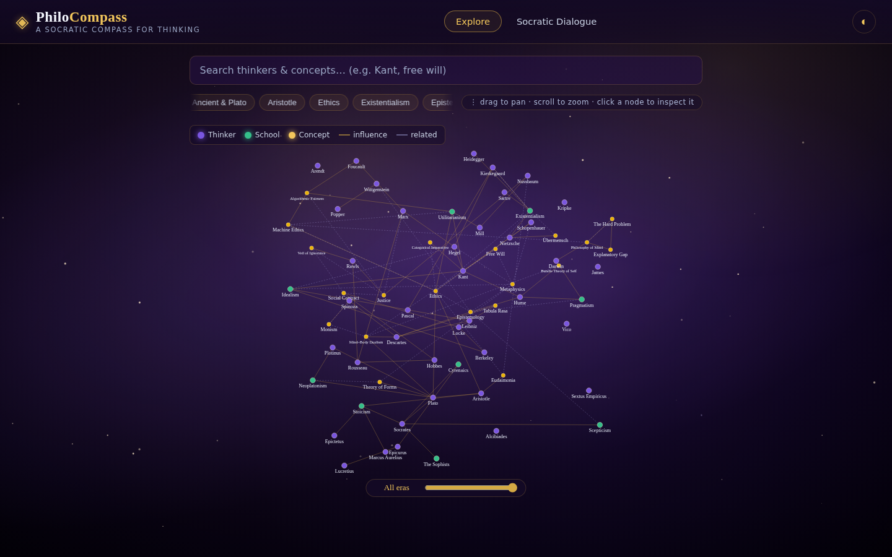
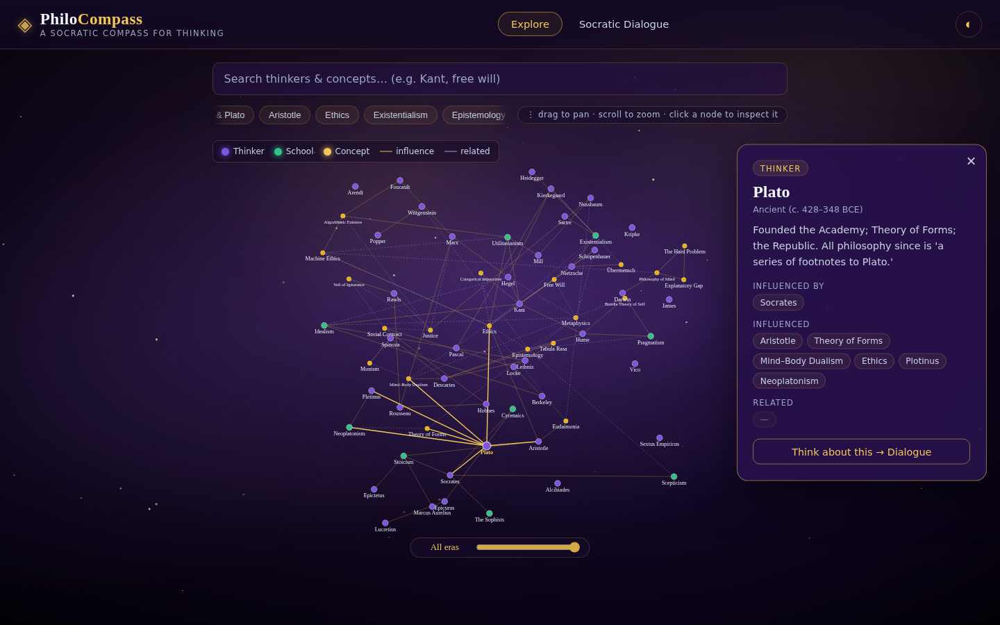
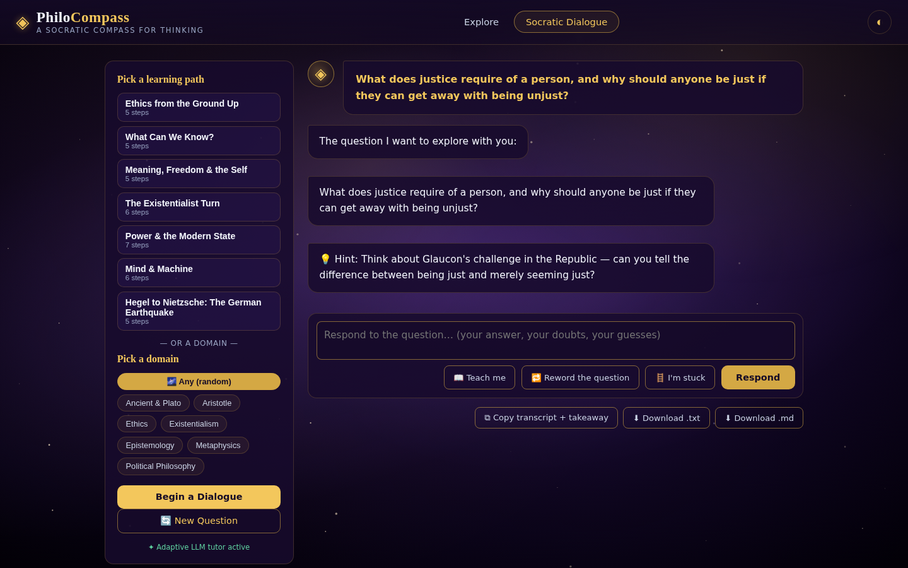
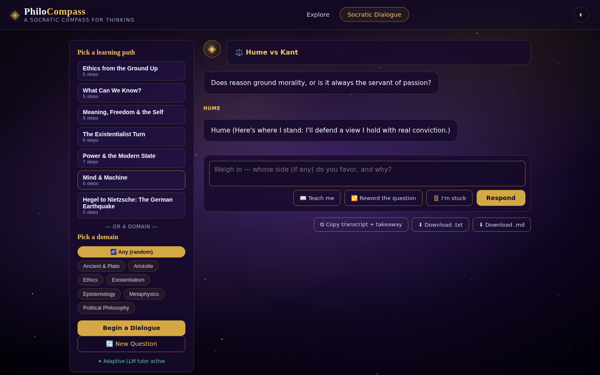

# 🧭 PhiloCompass — A Socratic Compass for Thinking

> Explore the galaxy of philosophy. Let a Socratic teacher question your thinking, and trace the lineage of ideas across two thousand years.

PhiloCompass turns the Socratic method into a living web app. It's built around a core conviction: **you learn philosophy by doing it — by being asked questions, not by being told answers.** The app draws you into that practice through an interactive constellation of thinkers and a dialogue engine that actually reasons with you.



---

## ✨ What it does

**🗺️ Explore the galaxy of ideas**
A drifting, pan-and-zoom constellation of **67 philosophers, schools, and concepts** linked by their real intellectual lineage. Hover an edge to see *why* two ideas connect (e.g. Hume → Kant: *"awakened me from my dogmatic slumber"*). Timeline-scrub through 2,500 years, or filter by domain.



**🗣️ Genuinely Socratic dialogue**
Every conversation is built on pedagogy, not canned Q&A:
- **Cognitive-state tracking** — the tutor classifies your reasoning move (claim, reason, tension, changed your mind…) and steers the next question to *where your thinking is*.
- **Reasoning momentum** — a live tally of your arguments, tensions met, and refinements.
- **Teacher's Lens** — shows *why* the tutor asked what it did, so the pedagogy is intentional and visible.
- **Thread-back** — gently flags when you've shifted ground and helps you name what changed.
- **Personalized takeaway card** — at the close, a steelmanned recap of the position you built.



**🪜 Get unstuck without being given the answer** — four graded helpers in the composer:
- **📖 Teach me** — builds your foundational knowledge of the topic *before* you reason
- **🔁 Reword** — re-casts the question in plainer language
- **🪜 I'm stuck** — three progressive scaffolds (concept → worked example → direct lead)
- And it works for **debates** too, not just dialogues

**⚖️ Debate mode**
Put two thinkers head-to-head and weigh in as judge — **15 curated rivalries** (Kierkegaard ⚔️ Nietzsche, Foucault ⚔️ Arendt, Marx ⚔️ Mill…) *or build your own* with any two thinkers on a question you choose.

**📚 Learning paths**
Seven guided sequences (The Existentialist Turn, Mind & Machine, Hegel to Nietzsche…) that walk you through a coherent journey step by step.



---

## 🧠 The pedagogy (why it works)

This isn't a chatbot with a question bank. It's designed around established learning science:

| Principle | How PhiloCompass applies it |
|---|---|
| **Constructivism** | New questions anchor to the topic you just explored ("connect it to you") |
| **Scaffolding** | Support that builds you up, then fades — never just hands over the answer |
| **Retrieval practice** | You regularly re-express the core idea in your own words |
| **Desirable difficulty** | When a view comes too easily, the tutor raises a counterexample |
| **Metacognition** | You're asked *why* you believe what you do, not just *what* you believe |
| **Steelmanning** | Your best position is restated *better* than you said it, then you refine it |

---

## 🚀 Running it

```bash
# 1. Set up
python3 -m venv venv
source venv/bin/activate
pip install -r requirements.txt

# 2. (Optional) Add an LLM key for adaptive dialogue
#    .env  →   OPENAI_API_KEY=...   OPENAI_BASE_URL=routellm.abacus.ai/v1

# 3. Run
uvicorn philo_app.main:app --port 8001
# → http://localhost:8001
```

**Runs fully offline.** Without an API key, the curated question bank, knowledge graph, debate engine, and all pedagogy still work — perfect for classroom demos with no internet. Add a key and the LLM upgrades the dialogue to fully adaptive.

---

## 🗂️ Project layout

```
philo_app/
  main.py              # FastAPI server + all API routes
  socratic_engine.py   # Offline dialogue engine + cognitive-state tracking
  socratic_llm.py      # Adaptive LLM upgrades (when a key is present)
  debate.py            # The debate engine (15 pairings + custom)
  data_thinkers.py     # The knowledge graph: 67 nodes, 107 edges, 7 paths
  envdot.py            # Tiny .env loader
  static/              # Vanilla-JS SPA (no build step)
    index.html         # The app shell
    app.js             # Frontend logic
    style.css          # Galaxy/gold theme
    sw.js              # Service worker (PWA, offline-after-first-load)
tests/                 # 18 backend tests + headless-Chromium QA scripts
docs/screenshots/      # Portfolio screenshots
```

---

## 🔒 Notes for contributors

- `.env` (API keys) is **git-ignored** — never commit it.
- The SPA is vanilla HTML/CSS/JS — no build step, by design.
- Changing frontend files? Bump the `?v=` cache-busters in `index.html` **and** the `CACHE_VERSION` in `sw.js` in lockstep, or the service worker will serve stale assets.

---

Made with wonder. Philosophy begins in one. 🔭
